<!-- Upload README.md with the full assets/ folder. Replace sample channel URLs and the bracketed team details before publishing. -->

<picture><source media="(prefers-color-scheme: dark)" srcset="assets/dark/hero.gif"><source media="(prefers-color-scheme: light)" srcset="assets/light/hero.gif">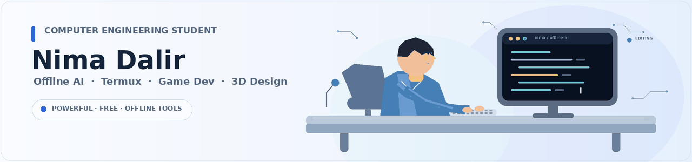</picture>

<h1>👋 سلام! من نیما دلیر هستم</h1>

<h1>Hi, I'm Nima Dalir</h1>

---

## 🎓 درباره من

**نیما دلیر**، متولد **۱۳۸۵** و دانشجوی **مهندسی کامپیوتر** هستم. به ساخت ابزارهای کاربردی هوش مصنوعی آفلاین، توسعه نرم‌افزار و تولید محتوای آموزشی علاقه دارم.

### 🔭 حوزه‌های تمرکز

- **Python و Termux:** لینوکس روی اندروید، بدون نیاز به روت
- **مدل‌های زبانی آفلاین:** اجرا و فاین‌تیون Ollama، llama.cpp و LM Studio روی سخت‌افزارهای معمولی
- **هوش مصنوعی کاربردی:** ساخت ایجنت‌های محلی، RAG و اتوماسیون با n8n
- **تولید محتوا:** آموزش فناوری و هوش مصنوعی و معرفی ابزارهای متن‌باز در YouTube و Telegram
- **بازی‌سازی:** Godot و Unity؛ منطق بازی، تولید رویه‌ای و سیستم‌های هوش مصنوعی
- **طراحی سه‌بعدی:** Blender؛ مدل‌سازی Hard-surface، نورپردازی و رندر برای ویدیوهای آموزشی
- **سبک سایبرپانک/تکنولوژی:** نئون، ترمینال‌ها و روند کاری مبتنی بر CLI

💡 **فلسفه:** «ابزارهای قدرتمند، آزاد و آفلاین — برای همه»

## 🎓 About Me

**Nima Dalir**, born in **2006**, is a **Computer Engineering student** interested in practical offline AI, software development, and educational content.

### 🔭 Core Focus

- **Python & Termux:** Linux on Android, no root required
- **Offline LLMs:** running and fine-tuning Ollama, llama.cpp, and LM Studio on consumer hardware
- **Applied AI:** local agents, RAG, and automation with n8n
- **Content creation:** technology and AI tutorials, and open-source tools on YouTube and Telegram
- **Game development:** Godot and Unity — game logic, procedural generation, and AI systems
- **3D design:** Blender — hard-surface modeling, lighting, and rendering for educational videos
- **Cyberpunk / tech aesthetic:** neon, terminals, and CLI-first workflows

💡 **Philosophy:** “Powerful, Free, Offline Tools — For Everyone”

---

<h2>🔎 در حال یادگیری</h2>

این روزها دنبال یادگیری بیشتر دربارهٔ هوش مصنوعی، مدل‌های زبانی، مهندسی پرامپت و ساخت ابزارهای کاربردی هستم.

<h2>🔎 Currently Exploring</h2>

I’m learning more about AI, LLMs, prompt engineering, and building practical AI tools.

<picture><source media="(prefers-color-scheme: dark)" srcset="assets/dark/exploring.gif"><source media="(prefers-color-scheme: light)" srcset="assets/light/exploring.gif">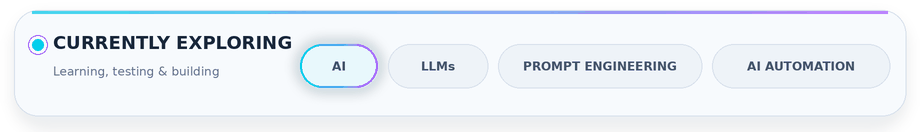</picture>

---

<h2>🛠 تکنولوژی‌ها و ابزارها</h2>

<h2>🛠 Tech Stack</h2>

آیکون‌ها با لوگوهای واقعی، در کپسول‌های ساده و سه‌بعدی با تأکید نئونیِ ملایم طراحی شده‌اند؛ نسخهٔ روشن و تیره هم دارند.

Authentic brand marks sit in clean 3D capsule buttons with subtle two-tone neon accents and light/dark variants.

<h3 dir="rtl" align="right">🐍 برنامه‌نویسی، هوش مصنوعی و اتوماسیون</h3>
<h4 dir="ltr" align="left">Programming, AI &amp; Automation</h4>

<picture><source media="(prefers-color-scheme: dark)" srcset="assets/dark/python.svg"><source media="(prefers-color-scheme: light)" srcset="assets/light/python.svg">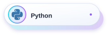</picture>&nbsp;&nbsp;
<picture><source media="(prefers-color-scheme: dark)" srcset="assets/dark/termux.svg"><source media="(prefers-color-scheme: light)" srcset="assets/light/termux.svg">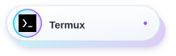</picture>&nbsp;&nbsp;
<picture><source media="(prefers-color-scheme: dark)" srcset="assets/dark/ollama.svg"><source media="(prefers-color-scheme: light)" srcset="assets/light/ollama.svg">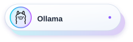</picture>&nbsp;&nbsp;
<picture><source media="(prefers-color-scheme: dark)" srcset="assets/dark/llama-cpp.svg"><source media="(prefers-color-scheme: light)" srcset="assets/light/llama-cpp.svg">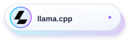</picture>&nbsp;&nbsp;
<picture><source media="(prefers-color-scheme: dark)" srcset="assets/dark/lm-studio.svg"><source media="(prefers-color-scheme: light)" srcset="assets/light/lm-studio.svg">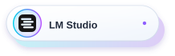</picture>&nbsp;&nbsp;
<picture><source media="(prefers-color-scheme: dark)" srcset="assets/dark/langchain.svg"><source media="(prefers-color-scheme: light)" srcset="assets/light/langchain.svg">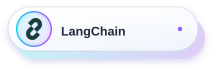</picture>&nbsp;&nbsp;
<picture><source media="(prefers-color-scheme: dark)" srcset="assets/dark/n8n.svg"><source media="(prefers-color-scheme: light)" srcset="assets/light/n8n.svg"></picture>&nbsp;&nbsp;
<picture><source media="(prefers-color-scheme: dark)" srcset="assets/dark/hugging-face.svg"><source media="(prefers-color-scheme: light)" srcset="assets/light/hugging-face.svg">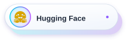</picture>

<h3 dir="rtl" align="right">🐧 لینوکس و موبایل</h3>
<h4 dir="ltr" align="left">Linux &amp; Mobile</h4>

<picture><source media="(prefers-color-scheme: dark)" srcset="assets/dark/linux.svg"><source media="(prefers-color-scheme: light)" srcset="assets/light/linux.svg">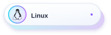</picture>&nbsp;&nbsp;
<picture><source media="(prefers-color-scheme: dark)" srcset="assets/dark/android.svg"><source media="(prefers-color-scheme: light)" srcset="assets/light/android.svg">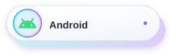</picture>&nbsp;&nbsp;
<picture><source media="(prefers-color-scheme: dark)" srcset="assets/dark/docker.svg"><source media="(prefers-color-scheme: light)" srcset="assets/light/docker.svg">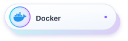</picture>

<h3 dir="rtl" align="right">🎮 بازی‌سازی و طراحی سه‌بعدی</h3>
<h4 dir="ltr" align="left">Game Development &amp; 3D</h4>

<picture><source media="(prefers-color-scheme: dark)" srcset="assets/dark/godot.svg"><source media="(prefers-color-scheme: light)" srcset="assets/light/godot.svg">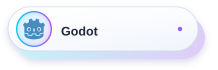</picture>&nbsp;&nbsp;
<picture><source media="(prefers-color-scheme: dark)" srcset="assets/dark/unity.svg"><source media="(prefers-color-scheme: light)" srcset="assets/light/unity.svg">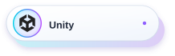</picture>&nbsp;&nbsp;
<picture><source media="(prefers-color-scheme: dark)" srcset="assets/dark/blender.svg"><source media="(prefers-color-scheme: light)" srcset="assets/light/blender.svg">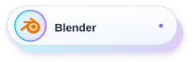</picture>

<h3 dir="rtl" align="right">🔧 ابزارهای توسعه</h3>
<h4 dir="ltr" align="left">Development Tools</h4>

<picture><source media="(prefers-color-scheme: dark)" srcset="assets/dark/git.svg"><source media="(prefers-color-scheme: light)" srcset="assets/light/git.svg"></picture>&nbsp;&nbsp;
<picture><source media="(prefers-color-scheme: dark)" srcset="assets/dark/github.svg"><source media="(prefers-color-scheme: light)" srcset="assets/light/github.svg">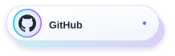</picture>&nbsp;&nbsp;
<picture><source media="(prefers-color-scheme: dark)" srcset="assets/dark/vscode.svg"><source media="(prefers-color-scheme: light)" srcset="assets/light/vscode.svg">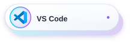</picture>&nbsp;&nbsp;
<picture><source media="(prefers-color-scheme: dark)" srcset="assets/dark/vim.svg"><source media="(prefers-color-scheme: light)" srcset="assets/light/vim.svg">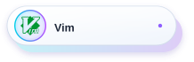</picture>

---

<h2>🚀 پروژه‌های شاخص</h2>

<h2>🚀 Featured Projects</h2>

<table>
<thead>
<tr>
<th width="22%">
پروژه

Project
</th>
<th>
جزئیات پروژه

Description &amp; Stack
</th>
<th width="18%">
وضعیت

Status
</th>
</tr>
</thead>
<tbody>
<tr>
<td valign="top" dir="ltr" align="left"><strong>Termux-LLM-Toolkit</strong></td>
<td valign="top">
اسکریپت‌های آماده برای اجرا و مدیریت LLM محلی در Termux

Ready-to-use scripts for running and managing local LLMs in Termux
 
<strong>تکنولوژی‌ها</strong>

<strong>Stack:</strong> <code>Python</code> · <code>Bash</code> · <code>Ollama</code> · <code>Termux:API</code>
</td>
<td valign="top">
<code>🟢 فعال</code>

<code>🟢 Active</code>
</td>
</tr>
<tr>
<td valign="top" dir="ltr" align="left"><strong>Offline-AI-Agent</strong></td>
<td valign="top">
ایجنت کاملاً آفلاین با Ollama و LangChain، بدون نیاز به API Key

Fully offline agent with Ollama and LangChain, no API key required
 
<strong>تکنولوژی‌ها</strong>

<strong>Stack:</strong> <code>Python</code> · <code>Ollama</code> · <code>LangChain</code> · <code>FastAPI</code>
</td>
<td valign="top">
<code>🟢 فعال</code>

<code>🟢 Active</code>
</td>
</tr>
<tr>
<td valign="top" dir="ltr" align="left"><strong>Content-Auto</strong></td>
<td valign="top">
اتوماسیون تولید محتوا از متن تا صدا و ویدیو

Content automation from script to audio and video
 
<strong>تکنولوژی‌ها</strong>

<strong>Stack:</strong> <code>n8n</code> · <code>Python</code> · <code>FFmpeg</code> · <code>TTS</code>
</td>
<td valign="top">
<code>🟡 در حال توسعه</code>

<code>🟡 WIP</code>
</td>
</tr>
<tr>
<td valign="top" dir="ltr" align="left"><strong>Blender-Assets</strong></td>
<td valign="top">
کتابخانه مدل‌های سه‌بعدی بهینه برای رندر سریع (Low-poly/PBR)

Optimized 3D asset library for faster rendering
 
<strong>تکنولوژی‌ها</strong>

<strong>Stack:</strong> <code>Blender</code> · <code>Python Add-ons</code>
</td>
<td valign="top">
<code>🟢 پایدار</code>

<code>🟢 Stable</code>
</td>
</tr>
</tbody>
</table>

---

## 👥 آشنایی با همکاران

**[علیرضا بخارائی]** — **[فعال در حوزه توسعه نرم افزار زیرساخت و امنیت]**  
**[ساخت اتوماسیون و ابزار های متعدد با همکاری هم]**

## 👥 Meet the Team

**[alireza-bokharaei]** — **[Software Development, Infrastructure, and Network Security]**  
**[Building automation and multiple tools together]**

<!-- Replace TELEGRAM_ID and INSTAGRAM_ID with the collaborator's real handles before publishing. -->

<a href="https://t.me/alireza_bokharaei_051"><picture><source media="(prefers-color-scheme: dark)" srcset="assets/dark/telegram.svg"><source media="(prefers-color-scheme: light)" srcset="assets/light/telegram.svg">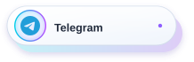</picture></a>&nbsp;&nbsp;
<a href="https://instagram.com/INSTAGRAM"><picture><source media="(prefers-color-scheme: dark)" srcset="assets/dark/instagram.svg"><source media="(prefers-color-scheme: light)" srcset="assets/light/instagram.svg">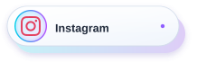</picture></a>

---

## 📚 کانال‌های آموزشی

**موضوعات:** هوش مصنوعی آفلاین، Termux، تولید محتوا، بازی‌سازی و Blender.

## 📚 Educational Channels

**Topics:** Offline AI, Termux, content creation, game development, and Blender.

<!-- Replace these example channel URLs before publishing. -->

<a href="https://youtube.com/@nextgen-ain8n"><picture><source media="(prefers-color-scheme: dark)" srcset="assets/dark/youtube.svg"><source media="(prefers-color-scheme: light)" srcset="assets/light/youtube.svg">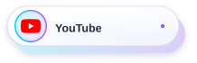</picture></a>&nbsp;&nbsp;
<a href="https://t.me/nextgen_ain8n"><picture><source media="(prefers-color-scheme: dark)" srcset="assets/dark/telegram.svg"><source media="(prefers-color-scheme: light)" srcset="assets/light/telegram.svg"></picture></a>

---

<h2>🌐 پورتفولیو و ارتباط</h2>

<h2>🌐 Portfolio &amp; Contact</h2>

<!-- Replace the PASTE_*_HERE href values with your real destinations before publishing. -->

<a href="PASTE_PORTFOLIO_URL_HERE"><picture><source media="(prefers-color-scheme: dark)" srcset="assets/dark/contact-portfolio.svg"><source media="(prefers-color-scheme: light)" srcset="assets/light/contact-portfolio.svg">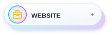</picture></a> <a href="https://www.linkedin.com/in/ndnima19/"><picture><source media="(prefers-color-scheme: dark)" srcset="assets/dark/contact-linkedin.svg"><source media="(prefers-color-scheme: light)" srcset="assets/light/contact-linkedin.svg">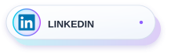</picture></a>  
<a href="https://github.com/ndnima/ndnima?v=2"><picture><source media="(prefers-color-scheme: dark)" srcset="assets/dark/contact-github.svg"><source media="(prefers-color-scheme: light)" srcset="assets/light/contact-github.svg">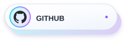</picture></a> <a href="mailto:dalirnima137@gmail.com"><picture><source media="(prefers-color-scheme: dark)" srcset="assets/dark/contact-email.svg"><source media="(prefers-color-scheme: light)" srcset="assets/light/contact-email.svg">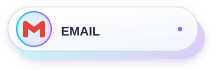</picture></a>  
<a href="https://t.me/ndnima"><picture><source media="(prefers-color-scheme: dark)" srcset="assets/dark/contact-telegram.svg"><source media="(prefers-color-scheme: light)" srcset="assets/light/contact-telegram.svg">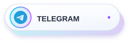</picture></a> <a href="PASTE_ORCID_URL_HERE"><picture><source media="(prefers-color-scheme: dark)" srcset="assets/dark/contact-orcid.svg"><source media="(prefers-color-scheme: light)" srcset="assets/light/contact-orcid.svg">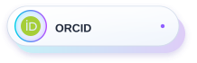</picture></a>

---

